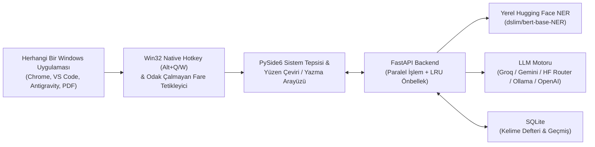

# 🌍 ContextLingo — Bağlam Odaklı Masaüstü İngilizce Okuma & Yazma Asistanı

<div align="center">


**Chrome, VS Code, Antigravity, PDF okuyucular ve Windows'taki tüm uygulamalarda çalışan; klasik kelime-kelime çeviri yerine metnin bağlamını, deyimlerini ve tonunu anlayan çift yönlü (EN ↔ TR) masaüstü İngilizce öğrenme ve yazma asistanı.**

</div>

---

## ✨ Temel Özellikler

- **🖱️ Her Uygulamada Çift Yönlü Anlık Çeviri (`Alt + Q` veya Fare Seçimi):**
  - Windows'taki herhangi bir uygulamada metni seçtiğinizde aktif pencere başlığını bağlam ipucu olarak alır, panonuzu bozmadan metni yakalar (64-bit Win32 `SendInput` + `GetClipboardSequenceNumber`) ve imlecin yanında modern bir yüzen kart açar.
  - **Otomatik Dil Algılama:** İngilizce seçerseniz **Doğal Türkçe Çeviri (`EN → TR`)**, Türkçe seçerseniz **Doğal İngilizce Çeviri (`TR → EN`)** üretir.
  - **Bağlam, Nüans & Kelime Kartları:** Metnin türünü (`Teknik / Yazılım`, `İş / Profesyonel`, `Günlük Sohbet`, `Akademik / Eğitim`) belirler, deyim/kalıp açıklaması sunar ve CEFR seviyeli (`A2–C2`) kelime kartlarını tek tıkla deftere kaydetmenizi sağlar.
- **✍️ Akıllı Yazma & Prompt Koçu (`Alt + W`):**
  - Türkçe yazdığınız bir mesajı, e-postayı veya yapay zeka promptunu **Günlük (`Casual`)**, **Profesyonel (`Professional`)**, **Teknik / AI Prompt (`Technical Prompt`)** ve **Akademik (`Academic`)** tonlarda doğal İngilizceye dönüştürür.
  - Bozuk/eksik İngilizce cümleleri düzeltip 2 alternatif ifade ve *"Neden bu kalıp seçildi?"* şeklinde Türkçe gramer açıklaması verir.
- **🏷️ Hibrit Hugging Face + LLM Mimarisi (Düşük Gecikme):**
  - Açılışta yerel Hugging Face NER modelini (`dslim/bert-base-NER`, `token-classification`, `aggregation_strategy="simple"`) arka planda RAM'e ön-yükler ve LLM çağrısıyla **paralel (`ThreadPoolExecutor`)** çalıştırır.
  - Kalıcı (keep-alive) HTTP istemcisi ve bellek içi LRU önbelleği sayesinde tipik yanıt süresi **~0,8 sn**, tekrarlanan metinlerde **<5 ms**'dir.
- **📚 Kişisel Kelime Defteri & Geçmiş (SQLite):**
  - Kaydedilen kelimeler, örnek cümleler, CEFR seviyeleri ve *"Öğrenildi / Tekrar Edilecek"* durumu yerel `SQLite` veritabanında saklanır.
- **🔌 Çoklu LLM Sağlayıcı Desteği & QLoRA Fine-Tuning Köprüsü:**
  - Sistem Tepsisi → **⚙️ Ayarlar** üzerinden tek tıkla **Groq API**, **Google Gemini API**, **Hugging Face Inference Router**, **Ollama (Yerel)** veya **OpenAI** arasında geçiş yapılabilir.
  - `training/qlora_translation_coach.py` dosyası, kendi özel İngilizce-Türkçe öğretmen LLM'inizi **4-bit NF4 QLoRA + PEFT + `trl.SFTTrainer`** ile eğitmek için hazır şablon içerir.

---

## 🏗️ Sistem Mimarisi



---

## 📂 Proje Yapısı

```text
ContextLingo/
├── backend/
│   ├── main.py                  # FastAPI uç noktaları, paralel HF+LLM yürütme, önbellek & startup warmup
│   ├── llm_client.py            # Çift yönlü (EN↔TR) bağlamsal çeviri & yazma koçu keep-alive LLM istemcisi
│   ├── nlp_pipeline.py          # Yerel Hugging Face NER (token-classification) & dil algılama
│   ├── db.py                    # SQLite kelime defteri ve işlem geçmişi katmanı
│   ├── config.py                # .env ve data/settings.json yapılandırma yönetimi
│   └── schemas.py               # Pydantic istek/yanıt veri şemaları
├── desktop/
│   ├── app.py                   # QSystemTrayIcon, arka plan QThread worker'ları & pencere orkestrasyonu
│   ├── hotkey_mouse.py          # Native Win32 RegisterHotKey (Alt+Q/W) & fare seçim dinleyicisi
│   ├── clipboard_capture.py     # 64-bit Win32 SendInput ile panoyu bozmadan seçili metin yakalama
│   ├── ui_popup.py              # Odak çalmayan mini '✨ Çevir' butonu & yüzen çeviri kartı
│   ├── ui_writer.py             # Yazma & Prompt Koçu penceresi (Alt+W)
│   ├── ui_vocab.py              # Kelime Defteri & Geçmiş penceresi
│   ├── ui_settings.py           # LLM sağlayıcı şablonları ve masaüstü ayarları
│   └── ui_styles.py             # Koyu tema QSS & HiDPI uyumlu konumlandırma
├── training/
│   └── qlora_translation_coach.py  # Mistral-7B 4-bit QLoRA + PEFT + SFTTrainer ince ayar şablonu
├── tests/
│   └── test_backend.py          # API, SQLite, JSON ayrıştırma, dil tespiti & Win64 SendInput testleri
├── run_app.py                   # Backend + Masaüstü uygulamasını tek komutta başlatıcı
├── baslat.bat                   # Windows tek tıkla başlatıcı
├── requirements.txt
└── .env.example
```

---

## 🚀 Kurulum ve Çalıştırma

### 1. Bağımlılıkları Yükleyin
```powershell
cd ContextLingo
pip install -r requirements.txt
copy .env.example .env
```

### 2. LLM Sağlayıcısını Ayarlayın
`.env` dosyasına (veya uygulama açıldıktan sonra Sistem Tepsisi → **⚙️ Ayarlar** penceresine) tercih ettiğiniz sağlayıcı bilgilerini girin:
- **Groq API (Önerilen — Ücretsiz & Çok Hızlı):** `LLM_PROVIDER=groq`, `LLM_BASE_URL=https://api.groq.com/openai/v1`, `LLM_MODEL=qwen/qwen3.8-27b`, `LLM_API_KEY=gsk_...`
- **Google Gemini API:** `LLM_PROVIDER=gemini`, `LLM_BASE_URL=https://generativelanguage.googleapis.com/v1beta/openai/`, `LLM_MODEL=gemini-2.5-flash`
- **Hugging Face Inference Router:** `LLM_PROVIDER=huggingface`, `LLM_BASE_URL=https://router.huggingface.co/v1`, `LLM_MODEL=Qwen/Qwen2.5-7B-Instruct`
- **Ollama (Yerel & İnternetsiz):** `LLM_PROVIDER=ollama`, `LLM_BASE_URL=http://localhost:11434/v1`, `LLM_MODEL=qwen2.5:3b`

### 3. Uygulamayı Başlatın
```powershell
python -B run_app.py
```
veya Windows'ta doğrudan **`baslat.bat`** dosyasına çift tıklayın.

- **`Alt + Q`** (veya fareyle metin seçince çıkan **`✨ Çevir`**): Seçili İngilizce veya Türkçe metni bağlama göre karşı dile çevirir ve kelime kartlarını gösterir.
- **`Alt + W`**: Yazma & Prompt Koçu penceresini açar.
- **Sistem Tepsisi (`EN` ikonu)**: Kelime Defteri, Ayarlar ve fare tetikleyicisi aç/kapat menüsüne erişim sağlar.

---

## 🧪 Testleri Çalıştırma

```powershell
python -B -m pytest -v
```

---

## 📄 Lisans

Bu proje **MIT Lisansı** altında sunulmaktadır.
