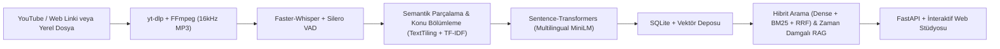

# 🎓 LectureMind — Ders, Seminer & Video Bilgi Çıkarım Stüdyosu

<div align="center">


**Uzun ders kayıtlarını, YouTube/web seminerlerini ve yerel ses/video dosyalarını zaman damgalı transkriptlere, otomatik konu bölümlerine, sınav/ödev özetlerine ve tıklanabilir zaman damgalı Soru-Cevap (RAG) bilgi tabanına dönüştüren yerel NLP stüdyosu.**

</div>

---

## ✨ Temel Özellikler

- **🌐 Evrensel Medya Alımı (`yt-dlp` + `FFmpeg`):** YouTube, Vimeo, TED ve `yt-dlp` tarafından desteklenen yüzlerce siteden herkese açık video/ses bağlantılarını veya yerel dosyaları (`.mp4`, `.mp3`, `.wav`, `.m4a`, `.mkv`, `.webm`, `.ogg`, `.flac`, `.avi`) 16 kHz mono MP3 formatına dönüştürür.
- **🎙️ Yüksek Doğruluklu Transkripsiyon (`Faster-Whisper`):** Silero VAD (`vad_filter=True`) ile sessizlikleri atlar; NVIDIA GPU (CUDA `int8_float16` / `float16`) varsa otomatik GPU'da çalışır, aksi durumda `cpu:int8` moduna güvenli geçiş yapar.
- **🧩 Semantik Konu Bölümleme (`TextTiling` + `TF-IDF`):** Konuşmayı anlamsal bütünlüğü koruyan parçalara ayırır; çok dilli vektör benzerliği kırılma noktalarına göre otomatik konu başlıkları ve anahtar kelimeler üretir (kaynak videoda hazır bölümler varsa onları da kullanır).
- **🔍 Hibrit Arama & Zaman Damgalı RAG (`Dense` + `BM25` + `RRF`):** `paraphrase-multilingual-MiniLM-L12-v2` (Türkçe + İngilizce) anlamsal vektör skorlarını `BM25Okapi` sözcüksel eşleşmesiyle **Reciprocal Rank Fusion (RRF)** üzerinden birleştirir.
- **📝 Akademik Vurgu & Çift Modlu Sentez:**
  - *Sıfır API Maliyeti (`local` varsayılan):* Embedding merkezilik (LexRank/Centroid) tabanlı bölüm/genel özet çıkarır; ders içinde geçen **sınav/vize/final**, **ödev/proje/teslim** ve **kritik kavram** cümlelerini zaman damgalarıyla listeler.
  - *İsteğe Bağlı LLM Modu:* `.env` üzerinden **Ollama** (`qwen2.5:3b` vb.), **Gemini** veya **OpenAI** bağlanarak akıcı RAG sentezine yükseltilebilir.
- **🎬 Akıllı Oynatıcı Senkronizasyonu & Dışa Aktarma:** YouTube bağlantıları için gömülü YouTube IFrame oynatıcısı, diğer siteler/dosyalar için HTML5 ses oynatıcısı sunar. Özet, bölüm veya Soru-Cevap kartlarındaki herhangi bir `[MM:SS]` zaman damgasına tıklandığında oynatıcı doğrudan o saniyeye atlar. Çalışma notları `.md`, `.txt` veya `.srt` olarak dışa aktarılabilir.

---

## 🏗️ Sistem Mimarisi



---

## 📂 Proje Yapısı

```text
LectureMind/
├── app/
│   ├── api/
│   │   └── routes.py            # FastAPI REST uç noktaları (ingest, search, ask, export)
│   ├── core/
│   │   ├── media_ingestor.py    # yt-dlp + FFmpeg medya indirici ve ses normalizasyonu
│   │   ├── transcriber.py       # Faster-Whisper (CUDA/CPU otomatik geçiş + VAD)
│   │   ├── chunker.py           # Semantik parçalama, TextTiling konu bölümleme, TF-IDF
│   │   ├── vector_store.py      # Çok dilli Sentence-Transformers + BM25 + RRF hibrit arama
│   │   ├── summarizer.py        # Extractive özetleme, sınav/ödev çıkarımı & çift modlu RAG
│   │   ├── database.py          # SQLite şeması (dersler, segmentler, bölümler, vektörler, QA)
│   │   └── pipeline.py          # Arka plan iş akışı orkestratörü
│   ├── static/
│   │   ├── index.html           # Tek sayfa stüdyo arayüzü
│   │   ├── styles.css           # Koyu tema responsive tasarım
│   │   └── app.js               # Canlı ilerleme takibi, YouTube/Audio seek, arama & QA
│   ├── config.py                # Pydantic Settings yapılandırması
│   └── main.py                  # FastAPI uygulama giriş noktası
├── tests/
│   ├── test_core.py             # Birim testleri (chunker, hibrit arama, QA, vurgu çıkarımı)
│   └── test_api.py              # API yaşam döngüsü ve dışa aktarma entegrasyon testleri
├── launch.py                    # Boş port bulucu (8000–8099) ve hazır olunca tarayıcı açıcı
├── LectureMind_Baslat.bat       # Windows tek tıkla başlatıcı
├── run.ps1                      # PowerShell başlatıcı
├── requirements.txt
└── .env.example
```

---

## 🚀 Kurulum ve Çalıştırma

### Ön Gereksinimler
- **Python 3.11+**
- Sistem `PATH` üzerinde **`ffmpeg`** / **`ffprobe`** kurulu olmalıdır (Windows'ta ör. `winget install Gyan.FFmpeg` veya `yt-dlp.FFmpeg`).

### 1. Windows'ta Tek Tıkla Başlatma
Klasördeki **[`LectureMind_Baslat.bat`](./LectureMind_Baslat.bat)** dosyasına çift tıklayın (veya PowerShell'de `.\run.ps1` çalıştırın).

Başlatıcı ilk açılışta `.venv` sanal ortamını ve bağımlılıkları kurar, ardından `launch.py` ile `8000–8099` aralığındaki ilk boş portu otomatik seçip sunucu hazır olduğunda tarayıcıyı açar.

### 2. Manuel Kurulum (Windows / Linux / macOS)
```bash
cd LectureMind
python -m venv .venv

# Windows:
.venv\Scripts\activate
# Linux / macOS:
source .venv/bin/activate

pip install -r requirements.txt
python launch.py
```

---

## ⚙️ İsteğe Bağlı LLM Ayarları (`.env`)

Varsayılan mod (`LECTUREMIND_LLM_PROVIDER=local`) hiçbir harici API anahtarına ihtiyaç duymadan çalışır. İstersen `.env.example` dosyasını `.env` olarak kopyalayıp LLM sağlayıcısı ekleyebilirsin:

```env
# Yerel Ollama
LECTUREMIND_LLM_PROVIDER=ollama
LECTUREMIND_OLLAMA_BASE_URL=http://localhost:11434
LECTUREMIND_OLLAMA_MODEL=qwen2.5:3b

# veya Gemini / OpenAI
# LECTUREMIND_LLM_PROVIDER=gemini
# LECTUREMIND_GEMINI_API_KEY=...
```

---

## 🔌 Temel API Uç Noktaları

Sunucu çalışırken interaktif Swagger belgeleri **`/docs`** adresinde sunulur:

| Metot | Uç Nokta | Açıklama |
| :--- | :--- | :--- |
| `GET` | `/api/health` | CUDA/CPU durumu ve aktif model yapılandırması |
| `GET` | `/api/lectures` | İşlenmiş ve devam eden tüm dersleri listeler |
| `POST` | `/api/lectures/url` | Web/YouTube bağlantısı ile analiz başlatır |
| `POST` | `/api/lectures/upload` | Yerel ses/video dosyası yükleyip analiz başlatır |
| `GET` | `/api/lectures/{id}` | Ders özeti, konu bölümleri, transkript ve QA geçmişi |
| `GET` | `/api/lectures/{id}/search?q=...` | Hibrit (Semantik + BM25) zaman damgalı arama |
| `POST` | `/api/lectures/{id}/ask` | Zaman damgalı kaynaklı Soru-Cevap (RAG) |
| `GET` | `/api/lectures/{id}/export?fmt=md\|txt\|srt` | Çalışma notlarını veya altyazıyı dışa aktarır |

---

## 🧪 Testler

```bash
python -m pytest -v
```

---

## 👨‍💻 Yazar & Lisans

**Raşit Tekin** — [GitHub @Rasittekin18](https://github.com/Rasittekin18)  
Bu proje **MIT Lisansı** altında sunulmaktadır.
