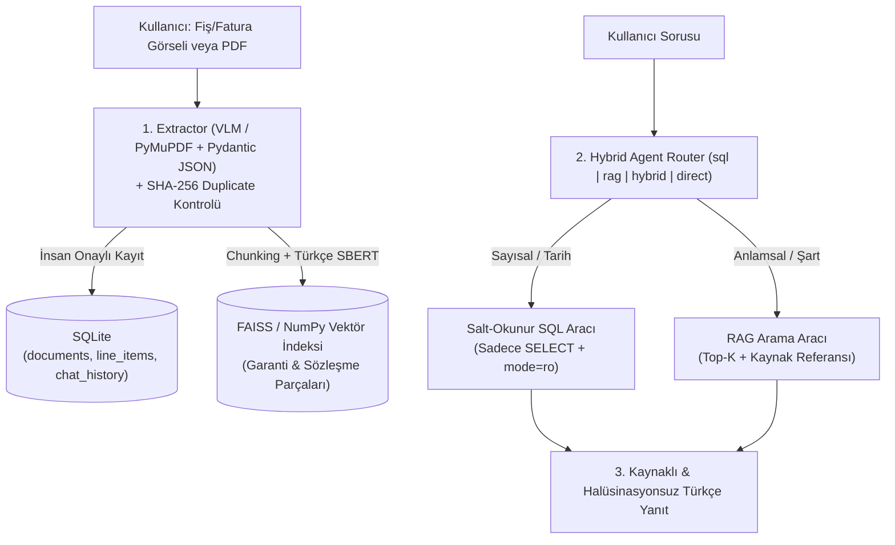

# 🧾 ReceiptGuard AI — Hibrit (VLM + SQL + RAG) Fiş, Fatura ve Garanti Takip Ajanı

<div align="center">


**Fiş, fatura, garanti belgesi ve tüketici sözleşmelerini yerel VLM/PDF okuyucuyla yapılandırılmış JSON'a çeviren; sayısal soruları salt-okunur SQLite ile, garanti/iade şartlarını ise Türkçe SBERT RAG indeksiyle halüsinasyonsuz yanıtlayan tam yığın (FastAPI + HTML/JS) yapay zekâ ajanı.**

</div>

---

## ✨ Temel Özellikler

- **🧠 Hibrit Hafıza (SQL + Vektör RAG):**
  - **Sayısal & Tarihsel Kesinlik (`SQLite`):** *"Bu ay markette ne kadar harcadım?"* veya *"Garantisi 30 gün içinde dolacak ürünlerim hangileri?"* gibi soruları vektör tahminine bırakmaz; kesin SQL sorguları çalıştırır.
  - **Anlamsal Metin Arama (`FAISS / NumPy + Türkçe SBERT`):** *"Sıvı teması kullanıcı hatası mı?", "İade koşulları neler?"* gibi garanti/sözleşme sorularını `emrecan/bert-base-turkish-cased-mean-nli-stsb-tr` gömme modeliyle arayıp kaynak belge ve benzerlik skoruyla yanıtlar.
- **👁️ VLM & PDF Çıkarım + İnsan Onaylı (Human-in-the-Loop) Önizleme:**
  - Görsel fiş/faturaları VLM (`qwen2.5vl:3b` vb.), seçilebilir metinli PDF'leri `PyMuPDF` + LLM (`qwen3:4b`) ile katı `Pydantic` JSON şemasına dönüştürür.
  - Kayıt öncesi sol tarafta orijinal belge önizlemesi, sağ tarafta düzenlenebilir form sunar; `SHA-256` hash kontrolüyle aynı belgenin iki kez kaydedilmesini önler.
  - Yerelde henüz VLM modeli indirilmemişse çökmez; kullanıcıya net yönlendirme ile birlikte manuel giriş/düzenleme imkânı (`needs_manual_review`) sunar.
- **🛡️ Güvenlik Duvarı (Guardrails):**
  - Agent'ın ürettiği SQL ifadeleri **yalnızca tekil `SELECT` / `WITH`** sorgularına izin verir; `DROP`, `DELETE`, `UPDATE`, `INSERT`, `ATTACH`, `PRAGMA`, SQL yorumları (`--`, `/*`) ve çoklu ifadeler (`;`) reddedilir, ayrıca SQLite salt-okunur (`mode=ro`) bağlantıda çalıştırılır.
  - SQL sözdizimi hatalarında 1 kez otomatik kendi kendini düzeltme (self-correction retry) mekanizması içerir.
  - Belge içi *Prompt Injection* saldırılarına karşı sistem talimatları ayrıştırılmıştır ve web arayüzü XSS kaçış korumalıdır.
- **🔌 Sağlayıcı Soyutlaması (Provider Pattern):**
  - Varsayılan olarak tamamen yerel **Ollama** (`qwen3:4b` / `qwen2.5:3b` + VLM için `qwen2.5vl:3b`) kullanır; istenirse arayüzdeki *Model Ayarları* panelinden veya `.env` üzerinden **Google Gemini API** ya da **OpenAI / Together API**'ye geçilebilir.

---

## 🏗️ Sistem Mimarisi



---

## 📂 Proje Yapısı

```text
ReceiptGuard-AI/
├── app.py                   # FastAPI uygulaması, REST API uç noktaları ve demo veri yükleyici
├── config.py                # Pydantic Settings yapılandırması (.env desteği)
├── requirements.txt
├── pytest.ini
├── .env.example
├── core/
│   ├── schemas.py           # Pydantic veri modelleri, kategori/tarih normalizasyonu, garanti bitiş hesabı
│   ├── database.py          # SQLite yönetimi, dashboard metrikleri ve salt-okunur SQL güvenlik duvarı
│   ├── llm_provider.py      # Ollama sağlık/VLM keşfi + Gemini / OpenAI sağlayıcı soyutlaması
│   ├── rag_engine.py        # Türkçe SBERT embedder + örtüşen chunking + kalıcı FAISS/NumPy indeksi
│   ├── extractor.py         # Görsel (VLM) ve PDF (PyMuPDF + LLM) yapılandırılmış veri çıkarıcı
│   └── agent.py             # Hibrit yönlendirici ajan (SQL + RAG + 1-retry SQL düzeltme + sentez)
├── static/
│   ├── index.html           # 4 sekmeli tek sayfa web arayüzü
│   ├── styles.css           # Koyu tema responsive tasarım
│   └── app.js               # Önizleme, grafikler, garanti tablosu, sohbet ve XSS koruması
├── tests/
│   └── test_core.py         # Birim ve entegrasyon testleri (7 test)
├── eval/
│   ├── test_cases.json      # Rota ve yanıt doğruluğu değerlendirme seti
│   └── run_eval.py          # Canlı Ollama + Türkçe SBERT uçtan uca eval betiği
└── data/
    ├── uploads/             # Yüklenen belgeler (.gitkeep)
    └── vector_index/        # Kalıcı vektör indeksi (.gitkeep)
```

---

## 🔌 API Uç Noktaları

| Yöntem | Uç Nokta | Açıklama |
| :--- | :--- | :--- |
| `GET` | `/` | Web arayüzünü (`static/index.html`) sunar |
| `GET` | `/api/status` | Ollama, VLM, Embedding ve veritabanı canlı durumunu döndürür |
| `POST` | `/api/settings` | Çalışma zamanında LLM/VLM sağlayıcı ve model ayarlarını günceller |
| `GET` | `/api/dashboard` | Harcama toplamları, kategori/ay grafikleri ve yaklaşan garantileri döndürür |
| `POST` | `/api/documents/extract` | Görsel/PDF yükler, duplicate kontrolü yapar ve düzenlenebilir önizleme üretir |
| `POST` | `/api/documents` | Onaylanan belgeyi SQLite + RAG indeksine kaydeder |
| `GET` | `/api/documents` | Belgeleri arama, kategori ve belge tipi filtreleriyle listeler |
| `GET` / `PUT` / `DELETE` | `/api/documents/{id}` | Belge detayını alır, günceller veya SQLite + Vektör DB + diskten siler |
| `POST` | `/api/chat` | Hibrit (SQL + RAG) ajana soru sorar; kullanılan rotayı, SQL'i ve kaynakları döndürür |
| `POST` | `/api/demo/seed` | Test için 4 adet örnek Türkçe fiş/fatura/garanti belgesi yükler |

---

## 🚀 Kurulum ve Çalıştırma

### Ön Gereksinimler
- **Python 3.11+**
- **[Ollama](https://ollama.com/)** (yerel LLM/VLM için)

### 1. Kurulum
```bash
cd ReceiptGuard-AI
python -m venv .venv

# Windows:
.venv\Scripts\activate
# Linux / macOS:
source .venv/bin/activate

pip install -r requirements.txt
```

### 2. Yerel Ollama Modelleri
```bash
ollama serve
ollama pull qwen3:4b        # Metin, yönlendirme ve SQL üretimi için (alternatif: qwen2.5:3b)
ollama pull qwen2.5vl:3b    # Görsel fiş/fatura okuması (VLM) için önerilen yerel model
```

*(Opsiyonel: `.env.example` dosyasını `.env` olarak kopyalayıp özel port veya Gemini/OpenAI API anahtarlarınızı tanımlayabilirsiniz.)*

### 3. Sunucuyu Başlatma
```bash
uvicorn app:app --host 127.0.0.1 --port 8000 --reload
```
Tarayıcıdan **`http://127.0.0.1:8000`** adresini açın. İlk deneme için sağ üstteki **Örnek Veri Yükle** butonunu kullanabilirsiniz.

---

## 🧪 Testler ve Değerlendirme (Eval)

Birim ve entegrasyon testlerini (SQL güvenlik duvarı, JSON/think ayrıştırma, RAG arama/silme, PDF çıkarımı, FastAPI uçtan uca akışı) çalıştırmak için:

```bash
pytest -v
```

Canlı **Ollama + Türkçe SBERT** ile uçtan uca rota ve içerik doğruluğu ölçümü için (`ollama serve` açıkken):

```bash
python eval/run_eval.py
```

---

## 🗺️ Sonraki Adımlar (Geliştirme Yol Haritası)

Projeyi bir sonraki aşamada aşağıdaki iyileştirmelerle genişletmek planlanmaktadır:
- [ ] **Gerçek Fiş/Fatura Görselleriyle VLM Benchmark:** `qwen2.5vl:3b` ve bulut VLM'ler üzerinde Türkçe fiş OCR doğruluk/alan bazlı F1 karşılaştırması.
- [ ] **Taranmış Çok Sayfalı PDF Desteği & Otomatik Döndürme:** Eğik/düşük ışıklı telefon fotoğrafları için OpenCV perspektif düzeltme ve kontrast ön işleme.
- [ ] **Proaktif Garanti Uyarıları & Dışa Aktarım:** Bitiş tarihine 30 gün kalan garantiler için e-posta/Telegram bildirimi ve aylık CSV/Excel harcama raporu dışa aktarımı.
- [ ] **Kullanıcı Düzenleme & Satır Bazlı Garanti Takibi:** Arşiv modalında belge alanlarını doğrudan düzenleme ve aynı faturadaki farklı ürünlere bağımsız garanti süresi atama arayüzü.
- [ ] **Çoklu Kullanıcı / Docker Paketlemesi:** `Dockerfile` + `docker-compose.yml` ile tek komutla kurulum.
