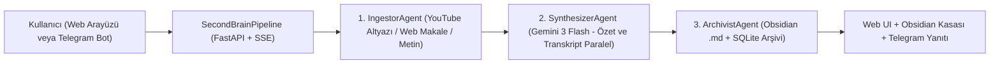

# Kişisel "İkinci Beyin" & Öğrenme Asistanı

İzlemeye vakit bulamadığın uzun **YouTube videolarını**, **teknik makaleleri** veya **ham notlarını** saniyeler içinde yapılandırılmış Türkçe öğrenme notlarına, aktif hatırlama tekrar kartlarına, **temizlenmiş uzun tam transkripte** ve **Obsidian uyumlu `.md` dosyalarına** dönüştüren **%100 ücretsiz** çoklu ajan (Multi-Agent) otomasyon platformu.

> Bu proje, *Yapay Zeka ile AI Agent Otomasyonu Yapmak* kursunda öğrenilen **İçerik Çekme → Yapay Zekâ Analizi → Arşivleme** mimarisinin, güncel teknolojiler (**Google GenAI SDK + Gemini 3 Flash + FastAPI SSE + SQLite + Obsidian Markdown + Telegram Bot**) ile günlük hayatta kullanıma hazır modern uyarlamasıdır.

---

## Öne Çıkan Özellikler

- **Çoklu Kaynak Desteği:** YouTube video linkleri (`watch?v=`, `youtu.be/`, `shorts/`), web makaleleri (`https://...`) ve doğrudan yapıştırılan düz metinler.
- **3 Aşamalı Canlı Çoklu Ajan Hattı:** Web arayüzünde SSE (Server-Sent Events) ve Telegram'da canlı durum mesajlarıyla ajanların adım adım çalışmasını izleme.
- **Yapılandırılmış Türkçe Özet (Structured Outputs):** Pydantic şemasıyla garantilenmiş TL;DR, önemli noktalar, ayrıntılı bölüm özetleri, uygulanabilir adımlar, teknik kavramlar/araçlar ve Obsidian etiketleri.
- **Düzenlenmiş Uzun Tam Transkript:** Altyazı veya konuşma dökümündeki yazım/noktalama hatalarını temizleyen, yabancı dilleri Türkçeye çeviren ve detayları kaybetmeden `###` alt başlıklarıyla paragraflara bölen tam metin çıktısı.
- **Etkileşimli Tekrar Kartları (Active Recall):** Öğrendiklerini pekiştirmek için soru-cevap flashcard'ları.
- **Notla Sohbet Et:** Kaydedilen herhangi bir notun içeriğine ve ham kaynağına dayalı takip soruları sorma.
- **Obsidian Uyumlu `.md` + SQLite Arşivi:** YAML frontmatter ve Obsidian callout'ları (`> [!summary]`, `> [!question]-`) içeren Markdown dosyaları diske yazılır; tüm notlar SQLite üzerinde aranabilir ve filtrelenebilir.
- **Ücretsiz YouTube Kanal Takibi (RSS):** Takip ettiğin YouTube kanallarının (`@tuncerbyte` vb.) son videolarını API kotası harcamadan YouTube RSS ile çekip tek tıkla özetleme.
- **Telegram Bot Entegrasyonu:** Telefondan bota link veya metin at; özet + düzenlenmiş transkript + `.md` dosyası doğrudan sohbetine gelsin.

---

## Mimari ve 3 Aşamalı Çoklu Ajan Akışı



### Ajanların Görevleri

1. **İçerik Ajanı (`IngestorAgent` — `app/agents/ingestor.py`):**
   - YouTube linklerinden `youtube-transcript-api` ile altyazıları, `yt-dlp` ve YouTube oEmbed üzerinden başlık, kanal adı, süre ve küçük resmi alır.
   - Makale linklerinden `httpx` + `trafilatura` (gerekirse `BeautifulSoup` yedeğiyle) reklamsız ana metni çıkarır.
   - YouTube kanallarının `@handle` veya URL bilgilerini ücretsiz RSS akışına (`feeds/videos.xml`) çözümler.
2. **Gemini Analiz Ajanı (`SynthesizerAgent` — `app/agents/synthesizer.py`):**
   - `synthesize()` ve `format_transcript()` çağrılarını `asyncio.gather()` ile eşzamanlı çalıştırır.
   - Yoğunluk (`503 UNAVAILABLE`) veya model erişim (`404`) durumunda otomatik olarak `gemini-3-flash-preview` → `gemini-3.1-flash-lite` → `gemini-3.8-flash` yedek zincirine geçer.
3. **Arşiv Ajanı (`ArchivistAgent` — `app/agents/archivist.py`):**
   - Türkçe karakterleri güvenli dosya adına çevirir (`YYYY-MM-DD_baslik.md`), YAML frontmatter + özet + tekrar kartları + düzenlenmiş tam transkripti içeren `.md` dosyasını `NOTES_DIR` klasörüne yazar ve SQLite'a (`data/second_brain.db`) kaydeder.

---

## Teknoloji Yığını

| Katman | Teknoloji / Paket | Kullanım Amacı |
| :--- | :--- | :--- |
| **Backend & Sunucu** | Python 3.12, FastAPI, Uvicorn | REST API, SSE canlı akış ve statik Web UI sunumu |
| **Yapay Zekâ SDK & Model** | `google-genai` (`1.x`), Gemini 3 Flash | Yapılandırılmış JSON özet (Structured Outputs), transkript düzenleme ve not içi sohbet |
| **İçerik Çekme** | `youtube-transcript-api`, `yt-dlp`, `trafilatura`, `beautifulsoup4`, `httpx` | Ücretsiz YouTube altyazısı, meta veri, web makale ayrıştırma ve YouTube RSS okuma |
| **Veri & Doğrulama** | SQLite (`sqlite3`), Pydantic v2, `pydantic-settings` | Kalıcı not/kanal arşivi ve tip güvenli şema doğrulama |
| **Web Arayüzü** | Vanilla HTML5 / CSS3 / JavaScript (ES6+) | Koyu temalı, sıfır build adımlı hızlı tek sayfa arayüz (`web/`) |
| **Telegram Bot** | `python-telegram-bot` (v21/22+ Async Polling) | Telefondan link işleme, arşiv arama ve `.md` dosya gönderimi |
| **Test** | `pytest`, FastAPI `TestClient` | Birim ve uçtan uca API/veritabanı testleri |

---

## Proje Klasör Yapısı

```text
SecondBrain-Assistant/
├── app/
│   ├── agents/
│   │   ├── __init__.py
│   │   ├── archivist.py       # Obsidian Markdown üretimi ve dosya yazma
│   │   ├── ingestor.py        # YouTube altyazı, makale ve RSS içerik çıkarma
│   │   ├── pipeline.py        # 3 aşamalı çoklu ajan orkestrasyonu ve SSE olayları
│   │   └── synthesizer.py     # Gemini analiz, transkript düzenleme ve soru-cevap
│   ├── bot/
│   │   ├── __init__.py
│   │   └── telegram_bot.py    # Async Telegram polling botu ve komutları
│   ├── __init__.py
│   ├── config.py              # .env ayarları ve dizin çözümleme
│   ├── database.py            # SQLite tablo yönetimi, migration ve arama
│   ├── main.py                # FastAPI uygulaması, lifespan ve API rotaları
│   └── schemas.py             # Pydantic veri modelleri
├── web/
│   ├── index.html             # Ana web arayüzü
│   ├── styles.css             # Koyu tema ve bileşen stilleri
│   └── app.js                 # SSE istemcisi, flashcard, sohbet ve arşiv yönetimi
├── tests/
│   └── test_core.py           # Birim ve entegrasyon testleri
├── notes/                     # Varsayılan Obsidian uyumlu .md çıktı klasörü
├── data/                      # SQLite veritabanı klasörü (second_brain.db)
├── .env.example               # Örnek ortam değişkenleri şablonu
├── .gitignore
├── baslat.bat                 # Windows tek tıkla başlatıcı
├── requirements.txt
├── run.py                     # Otomatik boş port seçen Uvicorn başlatıcı
└── README.md
```

---

## Kurulum Rehberi (Ücretsiz)

### 1. Python Sanal Ortamı ve Paketler
Projede standart Windows Python 3.12 (`py -3.12`) kullanılması önerilir:

```powershell
cd SecondBrain-Assistant
py -3.12 -m venv .venv
.\.venv\Scripts\python.exe -m pip install -r requirements.txt
```

### 2. Ücretsiz Gemini API Anahtarı Alma
1. [Google AI Studio](https://aistudio.google.com/apikey) sayfasına git ve Google hesabınla giriş yap.
2. **Create API key** butonuna tıkla ve anahtarını kopyala.
3. `.env.example` dosyasını `.env` adıyla kopyala (veya `baslat.bat`'ı ilk kez çalıştırarak otomatik oluştur) ve anahtarını ekle:

```env
GEMINI_API_KEY=buraya-google-ai-studio-anahtarini-yapistir
GEMINI_MODEL=gemini-3-flash-preview
```

### 3. (Opsiyonel) Ücretsiz Telegram Botu Bağlama
1. Telegram'da **`@BotFather`** hesabına `/newbot` yazıp botun için bir isim ve kullanıcı adı belirle.
2. Verilen HTTP API token'ını `.env` dosyasındaki `TELEGRAM_BOT_TOKEN=` satırına yaz.
3. *(İsteğe bağlı güvenlik)* Botu yalnızca kendi hesabına kilitlemek için Telegram'da `@userinfobot` üzerinden sayısal kullanıcı ID'ni öğrenip `TELEGRAM_ALLOWED_USER_IDS=` satırına ekle.

### 4. (Opsiyonel) Doğrudan Obsidian Kasasına Kaydetme
`.env` içindeki `NOTES_DIR` değerini kendi Obsidian Vault klasörüne yönlendirebilirsin:

```env
NOTES_DIR=C:\Users\Kullanici\Documents\ObsidianVault\Ogrenme-Notlari
```

### Ortam Değişkenleri Özeti (`.env`)

| Değişken | Varsayılan | Açıklama |
| :--- | :--- | :--- |
| `GEMINI_API_KEY` | *(boş)* | Google AI Studio ücretsiz API anahtarı (zorunlu) |
| `GEMINI_MODEL` | `gemini-3-flash-preview` | Birincil Gemini modeli (503/404 durumunda yedek modellere geçer) |
| `TELEGRAM_BOT_TOKEN` | *(boş)* | `@BotFather` bot token'ı (opsiyonel; boşsa sadece Web UI çalışır) |
| `TELEGRAM_ALLOWED_USER_IDS` | *(boş)* | Virgülle ayrılmış izinli Telegram kullanıcı ID'leri (opsiyonel) |
| `NOTES_DIR` | `./notes` | Üretilen `.md` dosyalarının kaydedileceği klasör |
| `HOST` | `127.0.0.1` | Sunucu dinleme adresi |
| `PORT` | `8090` | Tercih edilen port (doluysa otomatik sonraki boş porta geçer) |

---

## Çalıştırma ve Kullanım

### Tek Tıkla Başlatma (Windows)
Klasör içindeki **`baslat.bat`** dosyasına çift tıkla:
- `.env` yoksa `.env.example` üzerinden oluşturur.
- `run.py --open-browser` ile `8090` portunu (doluysa sıradaki ilk boş portu) seçer ve tarayıcıyı otomatik açar.
- `.env` içinde `TELEGRAM_BOT_TOKEN` tanımlıysa Telegram botunu da aynı anda arka planda başlatır.

### Terminalden Başlatma
```powershell
cd SecondBrain-Assistant
.\.venv\Scripts\python.exe run.py --open-browser
```

### Telegram Bot Komutları
Bot çalışırken doğrudan YouTube linki, web makale URL'si veya en az 40 karakterlik düz metin gönderebilirsin. Linkin yanına eklediğin metin **özel odak isteği** olarak işlenir (ör. `https://youtu.be/... sadece kod örneklerini çıkar`).

| Komut | Açıklama |
| :--- | :--- |
| `/start` | Botu başlatır ve kullanım özetini gösterir |
| `/son` | Arşivdeki son 5 öğrenme notunu listeler |
| `/transkript` | Son notun (veya `/transkript <id>`) düzenlenmiş tam transkriptini gönderir |
| `/ara <kelime>` | Başlık, özet, etiket ve transkriptlerde arama yapar |
| `/yardim` | Komut listesini gösterir |

---

## REST ve SSE API Uç Noktaları

| Metot | Yol | Açıklama |
| :--- | :--- | :--- |
| `GET` | `/` | Web arayüzünü (`web/index.html`) sunar |
| `GET` | `/api/status` | Gemini/Telegram yapılandırma durumu ve arşiv istatistikleri |
| `POST` | `/api/summarize` | Link veya metni senkron olarak özetleyip JSON döndürür |
| `POST` | `/api/summarize/stream` | 3 ajan aşamasını SSE (`text/event-stream`) ile canlı yayınlar |
| `GET` | `/api/notes` | `q`, `category`, `source_type`, `tag`, `limit` ile notları listeler |
| `GET` | `/api/notes/{note_id}` | Tek bir notun tüm alanlarını ve transkriptini döndürür |
| `GET` | `/api/notes/{note_id}/markdown` | Obsidian uyumlu tam `.md` dosyasını indirir |
| `GET` | `/api/notes/{note_id}/transcript` | Düzenlenmiş transkripti ayrı `.md` dosyası olarak indirir |
| `DELETE` | `/api/notes/{note_id}` | Notu SQLite'tan ve (varsayılan olarak) `notes/` klasöründen siler |
| `POST` | `/api/notes/{note_id}/ask` | Not içeriğine dayalı takip sorusunu Gemini ile yanıtlar |
| `GET` / `POST` | `/api/channels` | Takip edilen YouTube kanallarını listeler veya yeni kanal ekler |
| `GET` | `/api/channels/{id}/videos` | Kanalın son videolarını ücretsiz RSS akışından getirir |

---

## Testler ve Sorun Giderme

### Otomatik Testleri Çalıştırma
```powershell
cd SecondBrain-Assistant
.\.venv\Scripts\python.exe -m pytest -v tests/test_core.py
```

### Sık Karşılaşılan Durumlar
- **Port dolu hatası:** `run.py`, ayarlanan port (`8090`) meşgulse otomatik olarak sıradaki ilk boş porta geçer ve açılan adresi terminale yazar.
- **YouTube videosundan altyazı alınamıyor:** Videonun yükleyicisi tarafından altyazılar kapatılmış olabilir; yalnızca altyazısı (manuel veya otomatik) açık videolar işlenebilir.
- **Gemini `429` veya `503` hatası:** Ücretsiz katman geçici hız sınırına veya yoğunluğa takıldığında sistem otomatik olarak yedek Gemini modellerini dener; tüm modeller yoğunsa 30–60 saniye bekleyip tekrar deneyebilirsin.
- **Windows uzun dosya yolu (`WinError 206`):** Proje çok derin bir OneDrive/klasör yolunda olduğundan `requirements.txt` içinde `google-genai>=1.0.0,<2.0.0` sürüm aralığı sabitlenmiştir.
