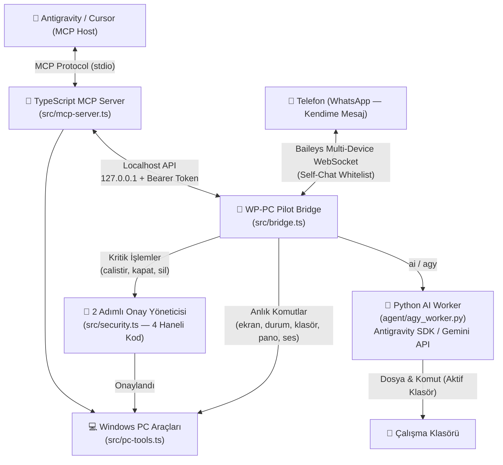

# 📱 WP-PC Pilot — WhatsApp Cep Bilgisayar Kumandası, Antigravity Ajanı & MCP Sunucusu

<div align="center">


> **🚧 GELİŞTİRİLME AŞAMASINDA (WORK IN PROGRESS):**  
> Bu proje aktif olarak geliştirilmektedir. Temel WhatsApp ↔ Windows PC uzaktan kontrol komutları, 2 adımlı güvenlik onayı, çift yönlü dosya aktarımı ve `stdio` tabanlı MCP sunucusu çalışır durumdadır; yapay zekâ ajanı orkestrasyonu, yeni masaüstü kontrol yetenekleri ve kullanıcı deneyimi iyileştirmeleri devam etmektedir.

**Ekstra mobil uygulama, port yönlendirme veya ücretli mesajlaşma API'si gerektirmeden; Windows bilgisayarınızı ve Antigravity / Gemini yapay zekâ ajanlarınızı doğrudan kendi WhatsApp sohbetinizden (*Kendime Mesaj*) yönetmenizi sağlayan çift yönlü otomasyon köprüsü ve MCP sunucusu.**

</div>

---

## ✨ Temel Özellikler

- **📱 Telefondan PC Kullanma Deneyimi (Ünlemsiz, Doğal ve Hızlı Komutlar):**
  - Ekran görüntüsü alma (`ekran` / `ss`), canlı CPU/RAM/disk/pil raporu (`durum`), açık pencereleri listeleme (`pencereler`), uygulama veya web sitesi açma (`aç chrome`, `aç youtube.com`), tek mesajla ekran kilitleme (`kilitle`).
  - **Çift Yönlü Dosya & Klasör Gezgini:** `klasör`, `gir masaüstü` / `gir 1`, `geri`, `bul <ad>` ve akıllı dosya gönderimi (`at <no veya ad>`). Ayrıca WhatsApp'tan kendine gönderdiğin herhangi bir fotoğraf veya PDF'in açıklamasına **`kaydet`** yazarak doğrudan PC'ye indirebilirsin.
  - **Pano, Ses, Medya ve Klavye Kontrolü:** PC panosunu telefona çekme (`pano`), telefondan PC panosuna kopyalama (`kopyala <metin>`), ses ayarı (`ses 50`, `ses kapat`), medya kontrolü (`medya`, `sonraki`, `önceki`), aktif pencereye metin yazma (`yaz`, `yaz-enter`) ve klavye kısayolları (`tuş alt+tab`, `tuş win+d`, `tuş enter`).
- **🧠 Uzaktan Yapay Zekâ Ajanı (`ai` / `agy`):**
  - `AGENT_BACKEND=auto` yapısıyla önce **Google Antigravity Python SDK (`google-antigravity`)** üzerinden dosya okuma/yazma ve geliştirme komutları çalıştırabilen otonom ajan başlatır; hazır değilse ücretsiz **Google Gemini API (`google-genai`)** arka ucuna düşer.
- **🔌 Gerçek TypeScript MCP Sunucusu (`stdio`):**
  - `@modelcontextprotocol/sdk`, `zod` ve `StdioServerTransport` ile geliştirilmiştir.
  - Antigravity (`~/.gemini/config/mcp_config.json`) veya Cursor (`~/.cursor/mcp.json`) gibi MCP istemcilerine bağlanarak AI ajanlarının da sana WhatsApp mesajı/dosyası gönderebilmesini ve PC durumunu/ekran görüntüsünü okuyabilmesini sağlar.
- **🛡️ Çok Katmanlı Güvenlik Duvarı:**
  - **Gönderici Kilidi (Self-Chat Whitelist):** Yalnızca QR okutulan hesabın kendi sohbeti (telefon JID + LID) kabul edilir; gruplar ve diğer sohbetler tamamen yok sayılır. Normal sohbet notları tetiklenmez.
  - **2 Adımlı Onay Kodu (`onay <4-haneli-kod>`):** PowerShell çalıştırma, uygulama kapatma, dosya silme (kalıcı silmek yerine Windows Geri Dönüşüm Kutusu'na taşır), uyku/kapatma ve riskli AI istekleri 2 dakika geçerli tek kullanımlık onay kodu gerektirir.
  - **Yerel API İzolasyonu:** MCP ↔ WhatsApp köprüsü yalnızca `127.0.0.1` üzerinde dinler ve rastgele `Bearer` token doğrulaması kullanır.

---

## 🏗️ Sistem Mimarisi



---

## 📂 Proje Yapısı

```text
WP-PC-Pilot/
├── package.json              # Node.js / TypeScript bağımlılıkları ve scriptler
├── tsconfig.json             # ESM + NodeNext TypeScript derleme ayarları
├── .env.example              # Ortam değişkenleri şablonu
├── .gitignore                # Oturum, .env, log ve ekran görüntüsü hariç tutmaları
├── baslat.bat                # Windows tek tıkla köprü başlatıcı
├── src/
│   ├── config.ts             # .env yükleyici ve Python sanal ortam çözümleyici
│   ├── security.ts           # Self-chat JID/LID whitelist, riskli prompt tespiti, 2 adımlı onay
│   ├── pc-tools.ts           # Windows ekran görüntüsü, dosya gezgini, pano, ses/medya, klavye
│   ├── agent-runner.ts       # Node ↔ Python stdin/stdout JSON köprüsü
│   ├── bridge.ts             # WhatsApp Baileys dinleyici, komut ayrıştırıcı ve 127.0.0.1 API
│   └── mcp-server.ts         # 6 araçlı TypeScript MCP sunucusu (stdio)
├── agent/
│   ├── requirements.txt      # google-antigravity, google-genai, python-dotenv
│   └── agy_worker.py         # Dual-backend (Antigravity SDK + Gemini fallback) AI çalıştırıcı
└── tests/
    └── smoke-test.mjs        # Güvenlik, ayrıştırıcı, PC araçları, Python ve MCP stdio testleri
```

---

## 📱 WhatsApp Komut Özeti

_(Ünlem `!`, `pc` öneki veya `< >` yazmana gerek yoktur; telefon klavyesinde doğrudan yazabilirsin.)_

| Kategori | Komutlar |
| :--- | :--- |
| **Ekran & Sistem** | `yardım`, `ekran` (`ss`), `durum`, `pencereler`, `aç chrome`, `aç youtube.com`, `kilitle` |
| **Dosya & Klasör** | `klasör`, `gir masaüstü` / `gir 1`, `geri`, `bul <ad>`, `at <no veya ad>`, *(medya + açıklama: `kaydet`)* |
| **Pano, Ses & Medya** | `pano`, `kopyala <metin>`, `ses 50` / `ses kapat` / `ses arttır`, `medya`, `sonraki`, `önceki` |
| **Klavye** | `yaz <metin>`, `yaz-enter <metin>`, `tuş enter` / `tuş alt+tab` / `tuş win+d` / `tuş esc` |
| **Kritik (Onaylı)** | `calistir <komut>`, `kapat-uyg <ad>`, `sil <no>`, `uyut`, `kapat <dk>`, `yenidenbaslat <dk>`, `iptal`, `onay <kod>` |
| **AI Ajanı** | `ai <görev>` veya `agy <görev>` |

---

## 🚀 Kurulum ve Çalıştırma

### Ön Gereksinimler
- **Windows 10 / 11**
- **Node.js 20+**
- **Python 3.11+**

### 1. Node.js Bağımlılıklarını Yükle ve Derle
```powershell
cd WP-PC-Pilot
npm install
npm run build
```

### 2. Python AI Worker Ortamını Kur *(İsteğe Bağlı — `ai` / `agy` komutu için)*
> **Windows İpucu:** Uzun klasör yollarında Windows 260 karakter sınırına takılmamak için sanal ortamı kısa bir yola (`%LOCALAPPDATA%\wp-pc-pilot-venv`) kurmanız önerilir; `src/config.ts` bu konumu otomatik algılar.

```powershell
python -m venv "$env:LOCALAPPDATA\wp-pc-pilot-venv"
& "$env:LOCALAPPDATA\wp-pc-pilot-venv\Scripts\python.exe" -m pip install -r agent\requirements.txt
```

### 3. `.env` Dosyasını Hazırla
`.env.example` dosyasını `.env` olarak kopyalayıp düzenleyin:
- `BRIDGE_API_TOKEN`: Güçlü ve rastgele bir yerel token belirleyin.
- `GEMINI_API_KEY`: `ai` / `agy` komutları için [Google AI Studio](https://aistudio.google.com/apikey) üzerinden ücretsiz anahtar alıp ekleyin.

### 4. Köprüyü Başlat ve WhatsApp QR Kodunu Okut
```powershell
npm run start:bridge
# veya Windows'ta doğrudan baslat.bat dosyasına çift tıklayın
```
Terminalde çıkan QR kodu telefonunuzdan **WhatsApp → Bağlı Cihazlar → Cihaz Bağla** ile okutun, ardından WhatsApp'ta **kendi sohbetinize** `yardım` yazın.

---

## 🔌 Antigravity / Cursor'a MCP Sunucusu Olarak Bağlama

Antigravity (`~/.gemini/config/mcp_config.json`) veya Cursor (`~/.cursor/mcp.json`) yapılandırmasına şu bloğu ekleyin:

```json
{
  "mcpServers": {
    "wp-pc-pilot": {
      "command": "node",
      "args": [
        "<PROJE_TAM_YOLU>/WP-PC-Pilot/dist/mcp-server.js"
      ]
    }
  }
}
```

### MCP Sunucusunun Sunduğu 6 Araç
| Tool Adı | Açıklama |
| :--- | :--- |
| `pc_system_status` | Canlı CPU, RAM, disk, pil ve en çok kaynak kullanan işlemler |
| `pc_take_screenshot` | Masaüstü ekran görüntüsü alıp dosya yolunu döner |
| `pc_find_files` | Belirtilen veya varsayılan klasörlerde dosya arar |
| `wp_bridge_status` | Yerel WhatsApp köprüsünün bağlantı durumunu kontrol eder |
| `wp_send_message` | WhatsApp üzerinden kendine (veya belirtilen numaraya) mesaj gönderir |
| `wp_send_file` | Bilgisayardaki bir dosyayı veya ekran görüntüsünü WhatsApp'tan yollar |

---

## 🧪 Testler

Güvenlik whitelist'i, 2 adımlı onay yöneticisi, esnek komut ayrıştırıcı, Windows PC araçları, Python worker doğrulaması ve MCP `stdio` JSON-RPC el sıkışmasını doğrulamak için:

```powershell
npm run test:smoke
```

---

## 🗺️ Geliştirme Yol Haritası (WIP Roadmap)

Proje aktif olarak geliştirilmekte olup sonraki sürümlerde şu özellikler planlanmaktadır:
- [ ] **Yerel Ollama Desteği (`AGENT_BACKEND=ollama`):** Hiç API anahtarı gerektirmeyen %100 çevrimdışı yerel LLM arka ucu.
- [ ] **Oturum Belleği (Multi-Turn Chat):** `ai` komutlarında önceki mesajları hatırlayan konuşma devamlılığı.
- [ ] **Sesli Komut Desteği (Whisper STT):** WhatsApp'tan sesli mesaj göndererek PC ve AI ajanı yönetebilme.
- [ ] **Gelişmiş Ekran & Pencere Etkileşimi:** Belirli pencereyi öne getirme, koordinat/ızgara tabanlı tıklama ve çoklu monitör seçimi.
- [ ] **Windows Başlangıç Servisi & Sistem Tepsisi (Tray):** Bilgisayar açıldığında arka planda sessizce başlayan servis modu.
