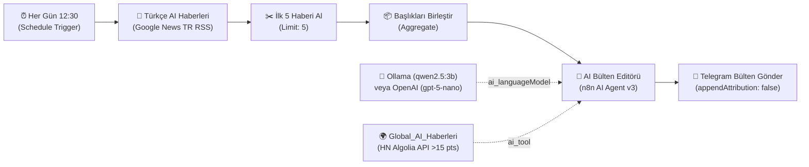

# 🤖 n8n AI & Tech Telegram Bülteni Ajanı

<div align="center">


-412991?logo=openai&logoColor=white)


**Sıfır ek API maliyetiyle ve hiçbir harici topluluk paketine ihtiyaç duymadan; her gün belirlenen saatte Türkiye ve dünya yapay zekâ gündemini otonom olarak derleyip özetleyen ve Telegram üzerinden paylaşan n8n Yapay Zekâ Ajanı (AI Agent) iş akışı.**

</div>

---

## ✨ Temel Özellikler

- **💸 %100 Ücretsiz ve Yerel LLM Alternatifi (Ollama `qwen2.5:3b`):**
  - OpenAI API anahtarı veya ücretli arama servisi (SerpAPI vb.) gerektirmeden tamamen kendi bilgisayarınızda çalışır.
  - 4 GB VRAM sınıfı ekran kartlarına (`100% GPU`, ~2.2 GB VRAM kullanımı) tam sığacak şekilde optimize edilmiş **Tool Calling** destekli `qwen2.5:3b` modeli ile ortalama **~24 saniyede** uçtan uca çıktı üretir (`numCtx: 4096`).
- **🔌 %100 Yerleşik n8n Düğümleri (Sıfır Topluluk Paketi Bağımlılığı):**
  - Harici/üçüncü parti topluluk paketleri yerine n8n'in kendi çekirdek düğümleri (`Schedule Trigger`, `RSS Read`, `Limit`, `Aggregate`, `AI Agent`, `HTTP Request Tool`, `Telegram`) kullanılmıştır.
- **🌐 Hibrit Haber Kaynağı Mimarisi (TR + Global):**
  - **Türkiye Gündemi:** `RSS Read` düğümü ile Google News Türkiye yapay zekâ akışını çeker, `Limit` (5 öğe) ve `Aggregate` ile bağlam penceresini şişirmeden sadece başlık ve tarihleri derler.
  - **Küresel Gündem:** `AI Agent` bağlı olan **`Global_AI_Haberleri`** (`HTTP Request Tool`) aracılığıyla Hacker News Algolia API üzerinden yüksek etkileşimli (`points > 15`) son yapay zekâ haberlerini optimize JSON (`title`, `url`, `created_at`) formatında alır.
- **📱 Temiz ve Tıklanabilir Telegram Çıktısı:**
  - `Europe/Istanbul` saat diliminde her gün `12:30`'da otomatik tetiklenir; çıktı uzunluğu Telegram limitleri için kontrol altında tutulur ve `appendAttribution: false` ile gereksiz alt imza eklenmez.
- **🔄 OpenAI Seçeneği Hazır:**
  - Yerel model yerine bulut modeli tercih edenler için aynı mimarinin `gpt-5-nano` uyarlaması da `workflows/` klasöründe sunulmuştur.

---

## 🏗️ Sistem Mimarisi



---

## 📂 Proje Yapısı

```text
n8n-AI-News-Telegram-Agent/
├── workflows/
│   ├── AI-Tech-Telegram-Bulten-Ollama.json   # %100 Ücretsiz yerel Ollama (qwen2.5:3b) iş akışı
│   └── AI-Tech-Telegram-Bulten-OpenAI.json   # Opsiyonel OpenAI (gpt-5-nano) iş akışı
└── README.md
```

---

## 🚀 Kurulum ve Çalıştırma

### 1. n8n Kurulumu (Lokal)
Bilgisayarınızda **Node.js** kuruluysa n8n'i global olarak kurup başlatın:
```bash
npm install n8n -g
n8n
```
Tarayıcıdan `http://localhost:5678` adresine giderek yönetici hesabınızı oluşturun.

### 2. Ollama ve `qwen2.5:3b` Modelinin Hazırlanması *(Ücretsiz Sürüm)*
```bash
ollama serve
ollama pull qwen2.5:3b
```
- n8n'de **Ollama** credential oluştururken **Base URL** alanına `http://127.0.0.1:11434` yazın (API Key boş bırakılır).

### 3. Telegram Botu ve Chat ID Alma
1. Telegram'da **`@BotFather`** hesabına `/newbot` yazarak botunuzu oluşturun ve **HTTP API Token**'ı kopyalayın.
2. Oluşturduğunuz botun linkine tıklayıp **Start** deyin ve `"merhaba"` yazın.
3. Tarayıcıdan `https://api.telegram.org/bot<TOKENINIZ>/getUpdates` adresine gidip `"chat": { "id": ... }` içindeki sayısal **Chat ID** değerinizi alın.

### 4. İş Akışını İçe Aktarma ve Çalıştırma
1. n8n arayüzünde yeni bir workflow oluşturup sağ üstteki **`...` → Import from file** menüsünden `workflows/AI-Tech-Telegram-Bulten-Ollama.json` (veya `OpenAI`) dosyasını yükleyin.
2. **Ollama Chat Model** (veya **OpenAI Chat Model**) düğümünden kendi credential'ınızı seçin.
3. **Telegram Bülten Gönder** düğümünde **Telegram API** credential'ınızı (BotFather token'ıyla) oluşturun ve **Chat ID** alanındaki `YOUR_TELEGRAM_CHAT_ID` değerini kendi sayısal Chat ID'niz ile değiştirin.
4. **Execute workflow** ile test edip Telegram mesajını doğrulayın, ardından sağ üstten **Publish / Active** durumuna getirin.

---

## 📊 Örnek Telegram Çıktısı

```text
🤖 Günlük Yapay Zekâ ve Teknoloji Bülteni

🇹🇷 Türkiye Gündemi:
1. Anthropic 83 dolardan girdi, 111,50'yi gördü: Yapay zekâ rallisinde yeni dönem mi? - Investing.com Türkiye
2. Anthropic seans sonrası düştü, yapay zeka endişeleri sürüyor - Investing.com Türkiye
3. ABD'den Çin'e yapay zeka çipi ihracatına yönelik lisans bilgilendirmesi - Bloomberght

🌍 Küresel Gündem:
1. Court: 4th Amendment Disallows Use Of AI-Generated 'Probable Cause' - TechDirt
2. An FBI agent called a Claude user about his chats - Substack
3. Should governments slow frontier AI? Jacob Coxon and Robin Hanson debate - YouTube
```

---

## 📄 Lisans

Bu proje **MIT Lisansı** altında sunulmaktadır.
